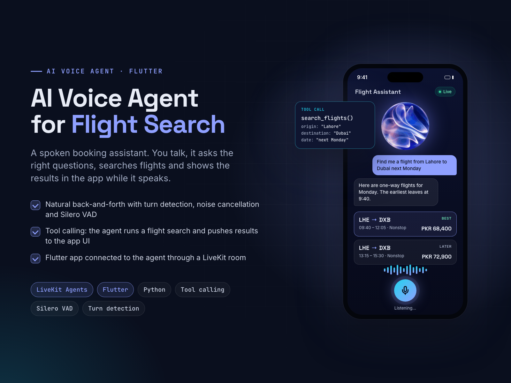

# AI Voice Agent for Flight Search

**LiveKit Agents + Flutter**

**Goal:** let travellers search flights just by talking, with no forms.

**Solution:** I built a voice agent on LiveKit Agents (Python). It asks for origin, destination, date and trip type step by step, handles interruptions with turn detection, Silero VAD and noise cancellation, then calls a flight-search tool. Results are pushed to the Flutter app through the LiveKit room, so flight cards appear while the agent is still speaking.

**Result:** a working end-to-end spoken booking assistant that can be adapted for clinics, hotels or support desks.

| | |
|---|---|
| **My role** | Solo developer: Python voice agent and Flutter app |
| **Skills** | AI Agent Development, Python, Flutter, Large Language Model, Mobile App Development |

## About this repository

This is a showcase repository. It contains the project poster and the poster's own HTML/CSS source in [`poster/`](poster/).
The app's source code is kept private.

To re-render the poster, open `poster/index.html` in Chrome at 1600×1200, or run `poster/render.sh` on macOS.

More of my work: **https://ahsanrazapk.github.io**
